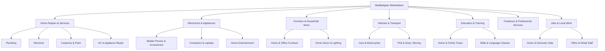

# MADDADGAAR — COMPLETE MARKETPLACE IMPLEMENTATION PLAN

**Target:** General-Purpose Local Classifieds & Services Marketplace (Lahore, Pakistan)  
**Document Purpose:** Sequential roadmap from audit to full production readiness  
**Priority Tiers:** P0 (Launch Blockers), P1 (Core Experience), P2 (Enhancements), P3 (Future)  

---

## 1. Information Architecture & Category Taxonomy

### 1.1 Category Hierarchy (Configurable & Managed in Database)
To preserve existing data while expanding into a full marketplace, existing plumbing and electrical records are grouped into `home_services`, alongside new top-level categories:

### 1.2 Universal Listing Data Model
Every listing shares the core identity while accommodating goods, services, and opportunities:
- **`listing_type`:**
  - `item_sale`: Physical goods being sold (furniture, mobile phone, generator).
  - `service_request`: Customer asking for help (leaking sink, tuition needed).
  - `service_offer`: Provider advertising services (experienced electrician, moving van).
  - `job_opportunity`: Employer or contractor seeking workers.
- **`pricing_model`:**
  - `fixed`: Specific PKR amount.
  - `negotiable`: Specific PKR amount with negotiation enabled.
  - `budget_range`: Low to High PKR estimate.
  - `quote_requested`: Poster wants bids/quotes.
  - `contact_for_price`: Price upon inquiry.
- **`item_condition` (for goods):** `new`, `like_new`, `good`, `fair`.
- **`location`:** `city_id` (Lahore), `area_id` (e.g., Gulberg, Johar Town), coarse neighborhood centroid. Precise street address remains strictly in `job_private` for service requests.

---

## 2. Execution Phases & Milestones

### Phase 1: Database & Store Evolution (P0 / P1)
- **Goal:** Backward-compatible migration extending `jobs` (or `listings` view) with `listing_type`, `pricing_model`, `price`, and `item_condition`.
- **Safety:** Existing plumbing & electrical rows are automatically assigned `listing_type = 'service_request'`, preserving all existing bids, bookings, and reviews without breaking foreign keys.
- **Implementation:** Migration `0002_general_marketplace.sql` with zero destructive drops.

### Phase 2: Design System & Editorial Palette (P0 / P1)
- **Visual Direction:** Editorial Humanism + Swiss Minimalism + Simple Classifieds Usability.
  - Background: Warm Paper `#F6F3EC`.
  - Surface: Warm Light `#FFFFFF`, Subtle `#EFECE3`, Borders `#E1DCD0`.
  - Text: Warm Dark Ink `#1F241E`, Muted Ink `#5A6256`.
  - Accent: Forest Olive `#44553C`, Emerald Highlights `#107C41`.
- **Typography:** Classic editorial serif headlines (Newsreader / Playfair / Merriweather), clean legible sans-serif for UI, and Noto Nastaliq Urdu for Urdu typography.
- **Components:** Restrained cards, generous whitespace, clear divider rules, no decorative neon gradients, blobs, or crypto aesthetics.

### Phase 3: Universal "Post an Ad" Workflow (P1)
- 4-step progressive wizard:
  1. **Listing Type & Category:** Plain English/Urdu choice (Selling an Item, Requesting a Service, Offering a Service, Posting a Job).
  2. **Details & Photos:** Title, category, rich description, condition (if item), photo upload.
  3. **Pricing & Terms:** Fixed, Negotiable, Budget Range, or Quote Request.
  4. **Location & Privacy:** City (Lahore), Neighborhood Area (Gulberg, DHA, etc.), optional private address notes for residential home visits.
- Client & Server validation with anti-duplication submission guards.

### Phase 4: Universal Search, Filters & Browse Directory (P1)
- Real-time search by keyword across all titles and descriptions.
- Filter by Category, Neighborhood Area, Listing Type, and Price Range.
- Direct listing cards showing photo, price badge, title, area, and timestamp.
- Direct navigation without requiring registration to browse.

### Phase 5: Response, Offers & Inquiries (P1)
- For items for sale: Direct buyer inquiry / offer submission.
- For service requests: Technician quote with arrival timing and estimate.
- For service offers: Customer question or booking request.
- Transactional state validation preventing duplicate acceptances or conflicts.

### Phase 6: Privacy, Verification & Demo Removal (P0)
- **Remove public demo persona switcher** from production builds (`ENABLE_DEMO_ACCOUNTS=false` in public production).
- Preserve test fixtures in `tests/acceptance.test.ts`.
- Private CNIC storage and admin-only review workflow.
- Strict server-enforced address protection.

### Phase 7: Required Public & Legal Pages (P1)
- Dedicated routes with clear navigation:
  - `/terms`: Terms of Service tailored to a Pakistani direct-settlement marketplace.
  - `/privacy`: Privacy Policy detailing phone OTP, address isolation, and document retention.
  - `/safety`: Safety Guidelines for in-person transactions and home visits.
  - `/help`: FAQs and user guides.
  - `/contact`: Official support and grievance reporting channels.

### Phase 8: Bilingual Polish & Accessibility (P1)
- Verified Urdu RTL layout (`dir="rtl"`) with natural Nastaliq typography.
- Mobile audit at 390px, 768px, and 1440px desktop.
- Touch targets ≥ 44px, color contrast ≥ 4.5:1, semantic headings, and keyboard navigation.

### Phase 9: Testing, Audit Verification & Production Deployment (P0)
- Run complete test suite and TypeScript validation.
- Verify production deployment at `https://maddadgaar.vercel.app`.
- Produce `MADADDGAAR_PRODUCTION_READINESS.md`.
